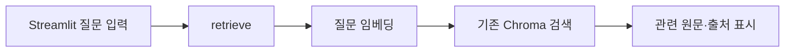

# 검색 베이스라인 실행 가이드

검색 담당 김원태. 청크 → OpenAI 임베딩 → 로컬 Chroma → `retrieve()` → 본문·출처 반환을 구현했습니다.
답변 생성 LLM과 임베딩 모델은 별개입니다. 이 검색 단계에는 Ollama 답변 생성 서버가 필요하지 않습니다.

## 팀원이 처음 실행할 때

현재 코드는 `retrieval/day2-sample-baseline` 브랜치에 있습니다. main에는 아직 병합하지 않았습니다.
Codex나 특정 PC의 폴더 없이, Python 3.11 또는 3.12와 uv가 있는 환경에서 실행합니다.

```bash
git clone --branch retrieval/day2-sample-baseline --single-branch https://github.com/yulesn/rfp-agent-part3-team1.git
cd rfp-agent-part3-team1
uv sync --frozen

# API 키·원본 자료 없이 실행하는 자동 테스트와 입력 검사
uv run pytest
uv run python scripts/retrieval_index.py --config configs/retrieval_demo.yaml validate --chunks examples/retrieval_demo/chunks.jsonl
```

공개 가상 문서 3건과 확인 질문은 `examples/retrieval_demo/`에 포함했습니다. 팀 원본 자료와 다릅니다.
자동 테스트는 테스트 전용 벡터를 쓰므로 실제 의미 검색 품질을 보장하지 않습니다.

실제 검색은 `.env.example`을 `.env`로 복사하고 `OPENAI_API_KEY`를 설정한 후 실행합니다.
파일 복사는 VS Code 탐색기에서도 가능합니다. 아래 build는 처음 한 번만 실행합니다.

```bash
uv run python scripts/retrieval_index.py --config configs/retrieval_demo.yaml build --chunks examples/retrieval_demo/chunks.jsonl --report data/processed/retrieval_demo/build-report.json
uv run python scripts/retrieval_index.py --config configs/retrieval_demo.yaml inspect
uv run python scripts/check_retrieval.py --report data/processed/retrieval_demo/search-check.json
uv run streamlit run app/retrieval_demo.py --server.address 127.0.0.1
```

브라우저에서 터미널에 나온 주소(기본 `http://127.0.0.1:8501`)를 엽니다. DB와 키가 없으면 준비 안내가 나오며 검색은 비활성화됩니다.
화면만 여는 것은 API를 호출하지 않습니다. 검색 버튼을 누르면 질문 임베딩 요청이 발생합니다.
예제 질문은 "한빛시청 도서관 통합 시스템의 사업 예산과 기간은?"이며 근거는 150,000,000원·4개월입니다.
확인 스크립트는 질문 3건 모두 1순위에 정답 문서와 근거가 있는지 검사합니다.
이 결과는 예제의 연결 확인이며 팀 전체 문서의 성능 평가가 아닙니다.

### 화면이 검색 코드를 호출하는 구조



화면 코드는 `app/retrieval_demo.py`에 있습니다. 아래 한 줄이 기존 검색 모듈과의 연결입니다.

```python
# 화면은 입력과 결과 표시를 맡고, 검색은 공통 함수를 그대로 사용합니다.
documents = retrieve(question, config)
```

각자 PC에서 같은 코드를 실행하는 로컬 앱입니다. 다른 사람의 localhost 주소에 접속하는 방식이 아닙니다.
팀의 최종 채팅 UI(`app/streamlit_app.py`)와 별도이며 답변 생성 에이전트는 호출하지 않습니다.

### 팀 기본 에이전트와 연결 시험

`scripts/check_agent_retrieval.py`는 팀 `build_graph()`에 준비된 `search_rfp`만 등록하여
질문 → 검색 도구 → Chroma → 근거 답변 흐름을 확인합니다.
도구는 그래프와 같은 설정을 받아 검색합니다. 기존 `build_graph(config)` 호출 방식과 기본 도구 목록은 유지합니다.
유영관 님의 `contributions/younggwan_rag`는 별도 구현이므로 이 시험만으로 해당 구현까지 통합한 것은 아닙니다.

```bash
# 저장 상태 확인. API를 호출하지 않습니다.
uv run python scripts/check_agent_retrieval.py

# 질문 임베딩과 답변 생성 API를 호출합니다. 기본 설정의 gpt-4o-mini를 사용합니다.
uv run python scripts/check_agent_retrieval.py --live --question "한영대학교 트랙운영 학사정보시스템 고도화의 사업 예산과 기간은?" --report data/processed/agent-retrieval-check.json
```

문서 전체를 다시 임베딩하지 않습니다. `connection_passed`는 도구 호출·응답·최종 답변이 이어졌는지 뜻합니다.
정답·출처가 실제 원문과 일치하는지는 별도로 확인합니다. 기존 보고서는 덮어쓰지 않으므로 새 실행에는 새 경로를 지정하세요.
전체 자동 테스트 75개와 Ruff를 통과했습니다. 실제 API 답변까지 성공한 것은 현재 미확인입니다.
2026-11-16 두 차례 실행 모두 HTTP 429 요청 제한으로 중단됐습니다.
오류 확인 응답의 코드는 `rate_limit_exceeded`, 유형은 `requests`였습니다. 요청 제한 해소 후 재확인합니다.

### 팀 DB를 받아서 검색할 때

공유받은 팀 DB 폴더 전체를 `data/vectorstore/`에 놓고 같은 모델·컬렉션 설정을 사용합니다.
이미 받은 DB를 다시 임베딩할 필요는 없습니다. 질문 임베딩용 API 키는 각 실행 환경에 설정합니다.
2026-11-16 생성한 공유 ZIP에는 `configs/team_rfp.yaml`, 실행 환경 버전, 검사 보고서와 사용법이 포함되어 있습니다.
현재 ZIP은 로컬에 준비했으며 팀 Drive에는 아직 업로드하지 않았습니다.

```bash
uv run python scripts/retrieval_index.py --config configs/team_rfp.yaml inspect
uv run streamlit run app/retrieval_demo.py --server.address 127.0.0.1 -- --config configs/team_rfp.yaml
```

### Colab에서 실행할 때

`notebooks/02_wontae_retrieval_check.ipynb`를 Colab에서 열고 위에서부터 실행합니다.
노트북은 같은 브랜치를 받아 uv.lock으로 환경을 맞추고 검사·DB 생성·검색 코드를 호출합니다.
키는 Colab 보안 비밀 `OPENAI_API_KEY` 또는 숨김 입력으로 받으며 코드나 출력에 저장하지 않습니다.
마지막 셀의 `input()`에서 질문을 입력합니다. Colab에서는 웹 화면을 외부로 공개하지 않고 노트북으로 검색을 확인합니다.
임베딩은 API에서 계산하므로 GPU 런타임은 필요하지 않습니다.

## 환경과 입력

저장소 루트에서 Python 3.11 또는 3.12로 실행합니다.

```bash
uv sync --frozen
cp .env.example .env
# .env의 OPENAI_API_KEY에 팀 키 입력. 키는 코드·노트북 출력·Git에 넣지 않음.
uv run python scripts/retrieval_index.py doctor
```

`doctor`는 키 설정 여부와 의존성 로딩만 확인하며 API를 호출하지 않습니다.
기본 샘플 설정은 `configs/retrieval_sample.yaml`: 1000자/겹침 200자, `text-embedding-3-small`, top_k=5입니다.
샘플 DB는 `data/vectorstore_sample_openai_v1/`, 컬렉션은 `rfp_sample_v1`입니다.

### 파싱 결과 documents.jsonl만 받은 경우

각 행에 `doc_id`, `text`, `metadata`가 있는 파싱 결과를 받으면 파싱을 반복하지 않고 청크 파일을 만듭니다.
아래 예시는 받은 파일을 `data/processed/received/documents.jsonl`에 둔 경우입니다.

```bash
uv run python scripts/export_chunks.py --documents data/processed/received/documents.jsonl --out data/processed/received/chunks.jsonl --report data/processed/received/export-report.json
```

재민 님의 `chunk_documents()`와 YAML의 청킹 설정을 사용하며 임베딩 API는 호출하지 않습니다.
각 행에는 `doc_id`, 전체 본문 `text`, `metadata`가 있어야 합니다.
문서 ID 중복·빈 본문·청크 메타데이터를 검사하고 검색용 `chunk_id`를 보완합니다.
기존 출력 파일은 덮어쓰지 않습니다. 이미 생성했다면 아래 입력 검사 단계로 진행하고, 다른 설정의 결과는 새 경로에 저장합니다.

### 이미 청크를 받은 경우

JSONL의 각 행은 다음 형태입니다. 본문과 값은 예시이며 metadata의 실제 키 이름은 전달받은 것을 보존합니다.

```json
{"page_content":"사업 예산은 1억원입니다.","metadata":{"doc_id":"사업.hwp","chunk_index":0,"사업 금액":100000000,"입찰 참여 마감일":"2026-11-30 18:00:00"}}
```

문서 처리 코드가 넘기는 `doc_id`와 `chunk_index`를 받습니다. 검색 입력 단계에서 `chunk_id`를
`doc_id#chunk_index` 형식으로 보완하고 원래 `chunk_index`도 유지합니다. 표 구분선 제거로 생긴 순번의 빈 구간은 다시 매기지 않습니다.
기존처럼 `doc_id`와 `chunk_id`를 직접 넘겨도 됩니다. 두 식별자 형식을 함께 주면 같은 청크를 가리켜야 합니다.

자동 검사: 빈 본문, 문서 ID·청크 순번/ID 누락, 잘못된 순번·ID, 중복 ID, 금액 정수, 유효한 날짜·시간.
날짜는 `YYYY-MM-DD`와 `YYYY-MM-DD HH:MM:SS`를 허용합니다. 메타데이터 키 이름과 날짜·시간 값은 바꾸지 않고 저장·검색 결과에 보존합니다.
시간 보존은 입력·저장을 위한 처리이며 날짜 범위 필터를 구현했다는 의미는 아닙니다.
본 베이스라인의 metadata 값은 문자열·숫자·불리언만 허용합니다. 빈 값은 키를 생략합니다.
원문과의 내용 일치, 파싱 누락, 페이지 정확성은 별도로 확인해야 합니다.

```bash
# 입력 파일 경로를 실제 받은 파일로 변경. API 호출 없음.
uv run python scripts/retrieval_index.py validate --chunks data/processed/chunks.jsonl --report data/processed/validation.json
```

이후 아래 build/search 명령에서 같은 파일을 사용합니다. JSONL 파일 형식은 수령용 CLI의 형식이며,
팀 파서가 메모리의 `list[Document]`를 넘기는 경우 `build_vectorstore(chunks, config)`를 직접 호출합니다.

### 청크 없이 CSV 텍스트로 확인하는 경우

제공 CSV를 `data/raw/data_list.csv`에 저장합니다. UTF-8 CSV이며 `파일명`, `텍스트` 열이 필요합니다.
학습용 고정 문자 수 분할로 유효한 첫 3문서를 준비합니다. 팀의 파싱·청킹 구현을 대체하지 않습니다.

```bash
uv run python scripts/retrieval_sample.py prepare --csv data/raw/data_list.csv
uv run python scripts/retrieval_index.py validate --chunks data/processed/retrieval_sample/chunks.jsonl --report data/processed/retrieval_sample/validation.json
```

이미 준비한 파일은 덮어쓰지 않습니다. 새로운 샘플은 설정의 processed_dir을 새 경로로 지정합니다.

## 실제 임베딩과 재접속·검색

아래는 샘플 경로입니다. 팀 청크를 받은 경우 `--chunks` 경로를 변경하세요.
build와 search는 실제 OpenAI API를 사용합니다. 문서와 질문을 같은 임베딩 모델로 변환합니다.

```bash
uv run python scripts/retrieval_index.py build --chunks data/processed/retrieval_sample/chunks.jsonl --report data/processed/retrieval_sample/build-report.json
# 새 프로세스에서 ready 상태와 청크 수 확인. inspect 자체는 API 호출 없음.
uv run python scripts/retrieval_index.py inspect
uv run python scripts/retrieval_sample.py search --query "이 사업의 예산과 기간은?"
```

팀 전체 DB를 만들 때는 명령의 **서브명령 앞에** `--config configs/default.yaml`을 지정합니다.
완성된 문서 처리 코드와 원본이 준비되면 기존 `scripts/build_index.py`로 전체 파이프라인을 실행할 수 있습니다.
GitHub의 최신 `build_index.py`는 기존 `documents.jsonl`이 있으면 파싱을 생략합니다.
청크는 메모리의 목록으로 임베딩 함수에 전달하며 청크 JSONL은 별도로 저장하지 않습니다.
중간 청크를 파일로 검사·보관하려면 위 `export_chunks.py`를 사용합니다.
문서 임베딩은 `embedding.batch_size`(기본 128개)로 요청을 나누어 처리합니다.
청크 길이 또는 모델이 달라지면 요청당 토큰 제한도 함께 확인해야 합니다.

```python
from rfp_agent.config import load_config
from rfp_agent.retrieval.retriever import retrieve

config = load_config("configs/retrieval_sample.yaml")
# 저장된 DB를 다시 열고 질문을 임베딩하여 관련 청크를 반환합니다.
documents = retrieve("사업 예산은 얼마인가?", config)
for document in documents:
    print(document.metadata["chunk_id"], document.page_content)
```

반환은 `list[Document]`이며 점수는 포함하지 않습니다. top_k는 YAML에서 읽습니다.
`filters`는 현재 Chroma where 문법을 전달하지만 공통 필터 계약과 조건 목록 검색은 후속 조율 대상입니다.
`search_rfp` 도구는 기본 설정을 읽어 본문·파일명·청크 ID·페이지(있을 때)를 반환합니다.
샘플 DB는 위 CLI 또는 설정을 넘긴 `retrieve()`로 확인하세요. 그래프 전체 연결은 에이전트 담당과 조율합니다.

## 저장·공유와 실패 처리

- 기존 컬렉션은 덮어쓰지 않습니다. 청크나 임베딩 모델이 바뀌면 새 경로/컬렉션으로 재생성합니다.
- DB 부재, 미완성 인덱스, 임베딩 모델 불일치는 오류입니다. 검색 조건 불일치는 빈 목록입니다.
- 컬렉션에는 모델과 완료 상태를 저장하며 API 키는 저장하지 않습니다.
- 팀 전체 DB는 김원태가 생성해 `data/vectorstore/` 폴더 전체를 Drive로 공유합니다.
- 공유 전 DB 사용 프로세스를 종료하고 DB 전체·사용 YAML·생성 보고서·uv.lock을 함께 전달합니다.
- `.env`, 원본 CSV, 청크, DB 파일, 실행 보고서는 Git 제외입니다. 받는 사람도 질문 임베딩용 키가 필요합니다.

## 확인 결과와 남은 범위

2026-11-16 재민 님의 `documents.jsonl` 100문서를 받아 같은 청킹 함수로 14,329청크를 재현했습니다.
청크 크기는 1000자, 중첩은 200자이며 최초 14,679개에서 표 구분선 350개를 제거한 결과입니다.
기존 Drive CSV와 파일명 100개가 모두 일치합니다. 앞서 실행한 공개 RFP/PyMuPDF 자료와는 다른 묶음입니다.

OpenAI `text-embedding-3-small`로 임베딩하여 `data/vectorstore/`의 `rfp` 컬렉션에 저장했습니다.
새 프로세스에서 다시 열어 14,329개 본문·메타데이터가 입력과 모두 같은지 확인했습니다.
질문 3개는 모두 상위 5개 안에서 기대한 근거를 찾았고 기관 일치·예산 범위 조건도 통과했습니다.
한영대학교 예산·기간과 한국연구재단 SW 개발비 근거는 1순위, 한국생산기술연구원 사업기간 근거는 2순위였습니다.
실제 문서 임베딩 성공 응답의 입력 토큰 합계는 8,221,513입니다.

위 DB·검색 검사에서는 답변 생성 LLM을 호출하지 않았으며 정식 검색 품질 평가도 아닙니다.
별도 에이전트 시험에서는 LLM 호출을 시도했지만 HTTP 429로 중단됐습니다.
공유 ZIP은 로컬에 준비했고, 팀 Drive 업로드·다른 팀원 환경 재현·에이전트 통합·main 병합은 남아 있습니다.
코드는 검색 작업 브랜치에서 리뷰하며, DB ZIP은 별도 공유 위치가 정해지면 전달합니다.
수령 데이터에 페이지 번호가 없어 파일명·청크 ID까지 출처를 보존하며 페이지 인용은 검증하지 않았습니다.

```bash
# 자동 테스트는 테스트 전용 임베딩을 사용하며 OpenAI API를 호출하지 않습니다.
uv run pytest
```

자동 테스트는 입력 검사, 저장·재접속·필터, 재생성 충돌 방지, 모델 불일치, 실패한 인덱스 차단,
검색 결과의 출처 표시를 확인합니다. 테스트용 벡터 결과를 의미 검색 성능으로 해석하지 않습니다.
